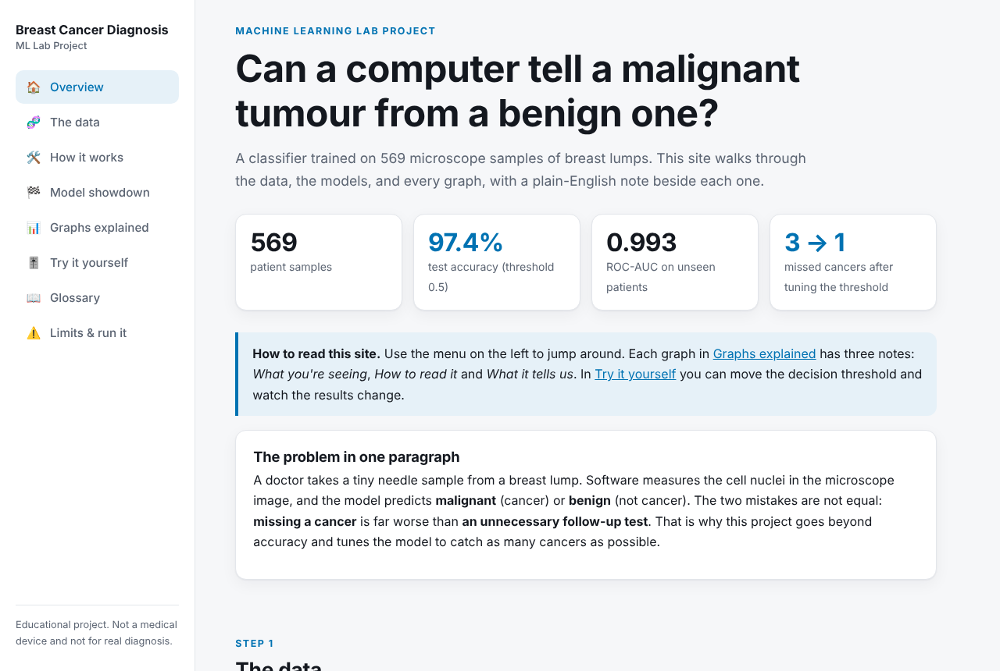
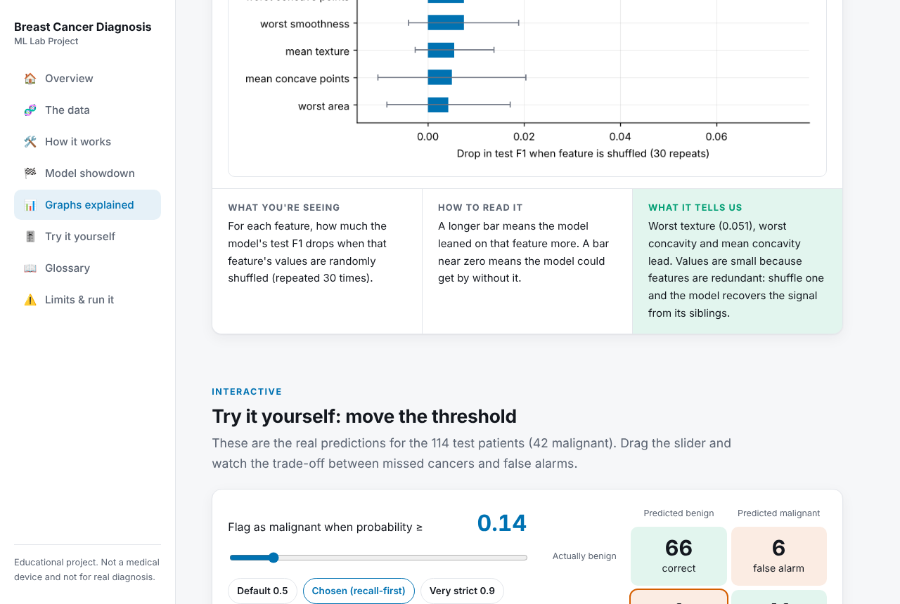
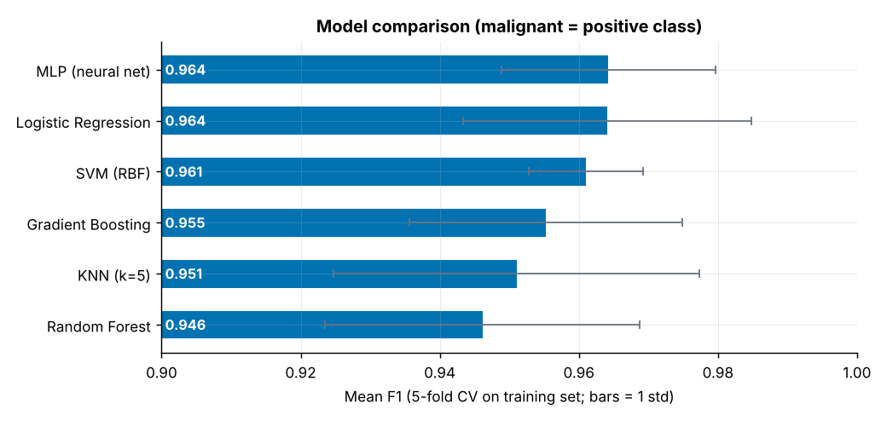
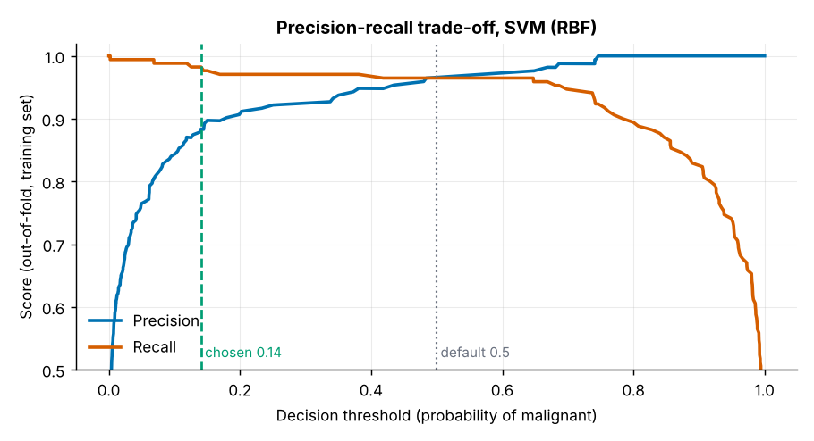
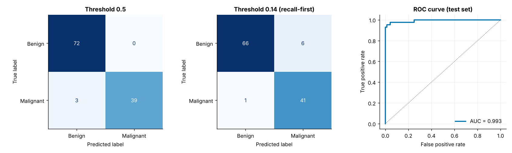
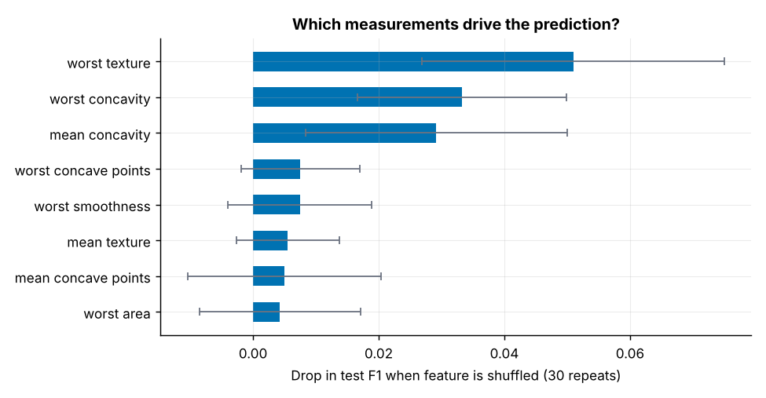

# Breast Cancer Diagnosis from Cell-Nucleus Measurements

**Machine Learning Lab Project: supervised binary classification**

> Predicts whether a breast tumour is malignant or benign from 30 cell-nucleus measurements. Compares six models with cross-validation, then tunes the decision threshold so fewer cancers are missed. Ships with an interactive website that explains every step and graph in plain English.

**Live demo:** https://mudili-tejaswini.github.io/breast-cancer-ml/



### Results at a glance

| | |
|---|---|
| Dataset | Wisconsin Diagnostic Breast Cancer: 569 patients, 30 features |
| Selected model | SVM (RBF kernel), tuned with grid search and 5-fold CV |
| Test accuracy | 97.4% at the default threshold |
| ROC-AUC | 0.993 on 114 unseen patients |
| Cancers missed | 3 at threshold 0.5, down to 1 at the recall-first threshold of 0.14 (at the cost of 6 false alarms) |

### What this project demonstrates

- **Sound evaluation:** stratified split, scaling inside a pipeline, cross-validation, and a test set used exactly once, so there is no data leakage.
- **Metric judgement:** precision, recall, F1 and ROC-AUC instead of accuracy alone, because a missed cancer costs far more than a false alarm.
- **Decision-making under asymmetric cost:** the threshold is chosen on out-of-fold training predictions, not on the test set.
- **Interpretability:** permutation importance, with an honest caveat about correlated features.
- **Honest reporting:** the limitations are stated, including a small test set and an untuned neural network.
- **Communication:** a documented report plus an interactive site with a live threshold slider.

**Tech stack:** Python, scikit-learn, pandas, NumPy, Matplotlib, HTML/CSS/JavaScript.

## Interactive website

The `docs/` folder is a self-contained website that walks through the data, the six models and every graph with plain-English explanations, plus a live slider for the decision threshold. Open `docs/index.html` in any browser (no server needed), or host it free on GitHub Pages: **Settings → Pages → Deploy from a branch → `main` → `/docs`**.



*The slider uses the real test-set predictions: drag the threshold and watch missed cancers trade off against false alarms.*

```
run_project.py        pipeline: trains, evaluates, writes figures + results + website data
assets/               screenshots used in this README
docs/                 the website (index.html, style.css, app.js, data.js, figures/)
figures/              the five result plots
results.json          every metric from the run
model_comparison_cv.csv
```

## 1. Problem statement

Given 30 numeric measurements computed from a digitised image of a fine-needle aspirate (FNA) of a breast mass, predict whether the tumour is **malignant** or **benign**.

This is a clinically asymmetric problem. A false negative (missing a cancer) is much more costly than a false positive (an extra biopsy). So the project goes beyond maximising accuracy: it chooses a decision threshold explicitly to favour recall on the malignant class.

## 2. Dataset

Wisconsin Diagnostic Breast Cancer (WDBC), available in `sklearn.datasets.load_breast_cancer`.

| Property | Value |
|---|---|
| Samples | 569 (212 malignant, 357 benign) |
| Features | 30 (mean, standard error, and "worst" of 10 nucleus properties such as radius, texture, concavity) |
| Missing values | 0 |
| Class balance | 37.3% malignant / 62.7% benign (mild imbalance) |

Malignant is treated as the positive class. sklearn encodes it as 0, so the label is flipped. Accuracy alone would be misleading here, so precision, recall, F1 and ROC-AUC are all reported.

**EDA findings** (`figures/01_eda.png`):
- The strongest single predictors are size and shape-irregularity features: worst concave points (|r| = 0.794), worst perimeter (0.783), mean concave points (0.777).
- The features are heavily redundant: 21 feature pairs have |r| > 0.9. This matters for interpretation (Section 7).

## 3. Methodology

1. **Split.** 80/20 stratified train/test (455 / 114). The test set is used exactly once, at the end.
2. **Preprocessing.** `StandardScaler` inside a scikit-learn `Pipeline`, so scaling is fitted only on the training folds and cannot leak.
3. **Model comparison.** Six model families, evaluated with 5-fold stratified cross-validation on the training set only.
4. **Tuning.** `GridSearchCV` (scored on F1) for SVM, Logistic Regression and Random Forest.
5. **Threshold selection.** Out-of-fold predicted probabilities on the training set pick the decision threshold, so the test set plays no part in the choice.
6. **Final evaluation.** The selected model is refit on the full training set and scored once on the test set.
7. **Interpretation.** Permutation importance on the test set.

## 4. Model comparison (5-fold CV, training set)

| Model | Accuracy | Precision | Recall | F1 | ROC-AUC |
|---|---|---|---|---|---|
| MLP (neural net) | 0.974 | 0.976 | 0.953 | 0.964 | 0.993 |
| Logistic Regression | 0.974 | 0.977 | 0.953 | 0.964 | 0.996 |
| SVM (RBF) | 0.971 | 0.977 | 0.947 | 0.961 | 0.995 |
| Gradient Boosting | 0.967 | 0.965 | 0.947 | 0.955 | 0.991 |
| KNN (k=5) | 0.965 | 0.988 | 0.918 | 0.951 | 0.987 |
| Random Forest | 0.960 | 0.958 | 0.935 | 0.946 | 0.988 |



**Observation.** The spread between models is small (F1 0.946 to 0.964), and the fold-to-fold standard deviation (0.008 to 0.026) is as large as the gaps between them. On this dataset the top models cannot be reliably told apart, so tuning is used as a tie-breaker rather than as proof of a winner. The simple linear model matching the neural network suggests the classes are close to linearly separable in the standardised feature space.

## 5. Hyperparameter tuning

| Model | Best parameters | CV F1 |
|---|---|---|
| **SVM (RBF)** | C = 10, gamma = "scale" | **0.9674** |
| Logistic Regression | C = 1 | 0.9640 |
| Random Forest | max_depth = None, min_samples_leaf = 1 | 0.9461 |

The tuned SVM had the highest CV F1 and was selected. The MLP was not tuned, so it could not be ruled out as a competitor; the margin over Logistic Regression is 0.003, well inside the noise.

## 6. Threshold selection and final test results

The default 0.5 threshold is arbitrary. Using out-of-fold probabilities on the training set, I picked the highest threshold that still achieves at least 98% recall on malignant cases: **0.14** (`figures/03_threshold.png`).



**Held-out test set (114 patients, 42 malignant):**

| Metric | Threshold 0.5 | Threshold 0.14 (recall-first) |
|---|---|---|
| Accuracy | 0.974 | 0.939 |
| Precision | 1.000 | 0.872 |
| Recall | 0.929 | **0.976** |
| F1 | 0.963 | 0.921 |
| Missed cancers (FN) | 3 | **1** |
| False alarms (FP) | 0 | 6 |

ROC-AUC on the test set: **0.993**.



**Reading the trade-off.** Lowering the threshold converts 2 of the 3 missed cancers into detections, at the cost of 6 extra false alarms among 72 benign patients. Whether that trade is worth it is a clinical decision, not a statistical one; the project shows both operating points and lets the stakeholder choose.

## 7. Interpretation

Permutation importance (drop in test F1 when a feature is shuffled, 30 repeats):

| Feature | Importance |
|---|---|
| worst texture | 0.051 |
| worst concavity | 0.033 |
| mean concavity | 0.029 |
| worst concave points | 0.008 |
| worst smoothness | 0.007 |



**Caveat.** Importance values are small and spread out because the features are highly correlated (21 pairs with |r| > 0.9). When one of a correlated group is shuffled, the model recovers the signal from its siblings, so each feature looks less important than the group really is. These numbers should be read as "which features carry information the others do not", not as a ranking of true clinical relevance. A likely reason worst texture ranks above the size features that dominate the simple correlation ranking is that texture is less redundant with the rest, though this report does not test that directly.

## 8. Limitations

- **Small test set.** With 114 patients, one patient moves recall by about 2.4 points. The 3 versus 1 missed cancers difference is suggestive, not conclusive. Repeated or nested cross-validation would give tighter estimates.
- **Single dataset, single institution.** Performance on images from other labs or scanners is untested.
- **Features are pre-computed.** The model sees measurements, not raw images; a CNN on the images is a different (and harder) problem.
- **Not a medical device.** This is a teaching project and must not be used for real diagnosis.

## 9. Possible extensions

- Nested cross-validation to compare models fairly, including a tuned MLP.
- Probability calibration (Platt/isotonic) and a reliability diagram.
- SHAP values for per-patient explanations.
- Dimensionality reduction (PCA) to address the feature redundancy.

## 10. Reproducing

```bash
pip install -r requirements.txt
python run_project.py
```

Outputs: `figures/*.png`, `model_comparison_cv.csv`, `results.json`. Random seed is fixed (42), so results are reproducible.
